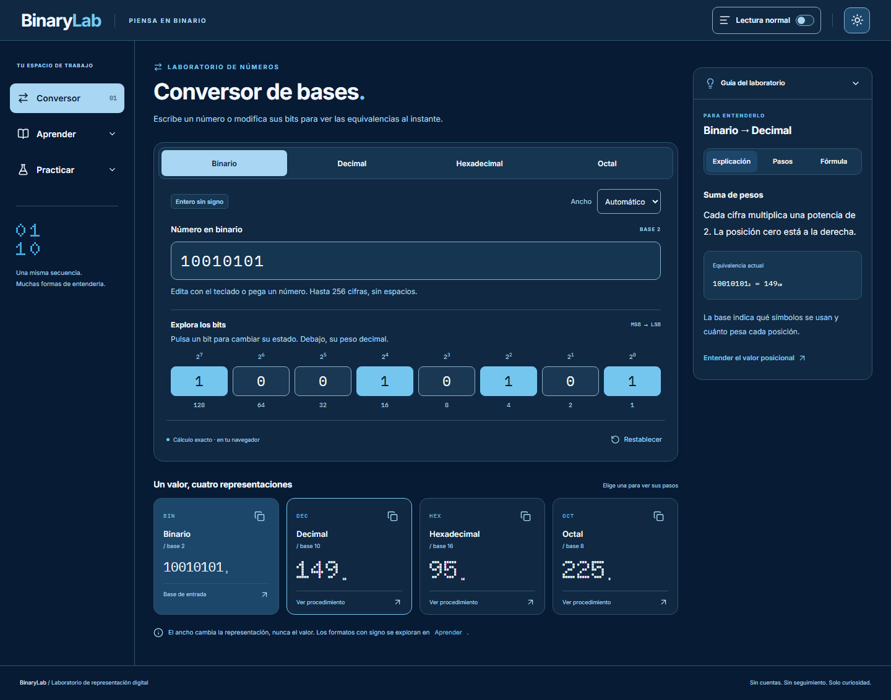

**[English](README.md) | [Español](README.es.md)**

# BinaryLab

**[Demo en vivo](https://binarylab-interactive.netlify.app/)**

Un laboratorio visual para aprender sistemas de numeración y representación de información en un ordenador. Convierte entre bases, edita bits y sigue los cálculos paso a paso; después, explora la teoría y practica con ejercicios guiados.

La documentación está disponible en inglés y español. Actualmente, la aplicación solo está disponible en español.



Captura real del conversor en modo oscuro.

## Funcionalidades

- **Convertir:** entrada binaria, octal, decimal y hexadecimal, edición directa de bits, anchura seleccionable y procedimientos de conversión paso a paso.
- **Aprender:** 25 temas, un glosario y demostraciones interactivas de aritmética binaria, enteros con signo, BCD, fracciones, IEEE 754, texto y color.
- **Practicar:** 84 actividades en 21 categorías, con modos test y respuesta escrita, pistas y corrección razonada.
- **Leer cómodamente:** distribución adaptable a escritorio, tablet y móvil, temas claro y oscuro, y modo Lectura cómoda.

Los cálculos se ejecutan en el navegador. No hay cuentas, backend ni analítica, y no se guardan preferencias, respuestas ni progreso.

## Arquitectura y decisiones técnicas

React y TypeScript estricto estructuran la interfaz; Vite y Tailwind CSS se encargan del build y los estilos. React Router gestiona la navegación, Radix UI aporta las bases de diálogos y pestañas, y Lucide React proporciona los iconos.

```text
src/domain/      Cálculo puro y evaluación de respuestas
src/content/     Temas, glosario, actividades y definiciones de evaluación
src/features/    Flujos de conversión, aprendizaje y práctica
src/components/  Componentes de interfaz compartidos
src/app/         Estructura de la aplicación y rutas
e2e/             Pruebas de navegación e interacción en navegador
```

- **Exactitud donde se necesita:** los [cálculos con enteros](src/domain/numerals.ts) usan `bigint`, incluidos valores superiores a `Number.MAX_SAFE_INTEGER`. El [módulo de representaciones](src/domain/representations.ts) utiliza numeradores y denominadores `bigint` para fracciones exactas, y `DataView` y `ArrayBuffer` para mostrar las representaciones IEEE 754 y su redondeo.
- **Evaluadores tipados:** las [reglas de evaluación y validación](src/domain/answers.ts) distinguen respuestas enteras, racionales, de patrones de bits y conceptuales. La evaluación distingue los valores incorrectos de las entradas vacías y los errores de formato. Las actividades de tipo test ofrecen cuatro alternativas completas con una sola correcta.
- **Comprobaciones independientes:** Vitest y React Testing Library verifican el dominio y los componentes. Las [pruebas de contenido](src/content/content.test.ts) contrastan las 84 soluciones con un oráculo independiente de respuestas esperadas y utilizan huellas revisadas para detectar cambios educativos. Playwright comprueba los flujos en navegador.

Consulta la [arquitectura y los contratos](docs/architecture.md) y el [proceso de integridad del contenido](docs/content-integrity.md).

## Ejecución local

Necesitas Node **24.22.2**, fijado en [.nvmrc](.nvmrc), y npm. Activa esa versión con tu gestor de Node y ejecuta desde la raíz del proyecto:

```sh
npm ci
npm run dev
```

Abre [127.0.0.1:5173](http://127.0.0.1:5173/). El puerto debe estar libre.

## Verificación

Después de instalar las dependencias:

```sh
npm run check
npm run test:toolchain
npm run browser:install
npm run test:e2e
```

`check` valida avisos de terceros, TypeScript, ESLint, Prettier, pruebas unitarias/de interfaz y el build de producción. La comprobación del toolchain valida la versión fijada de Node y ejecuta pruebas específicas de compatibilidad de dependencias. Playwright instala Chromium en `artifacts/pw-browsers/` y comprueba ese build con la configuración propia del proyecto. Mantén libre el puerto **4173** para que las pruebas sirvan esta copia de la aplicación. En Linux, las dependencias del sistema pueden instalarse con `npm run browser:install -- --with-deps`.

**Última validación local de la aplicación: 2 de noviembre de 2026, Node 24.22.2.** `npm run check` correcto, con **174 pruebas unitarias, de interfaz y de build en nueve archivos**; `npm run test:e2e` superó las **27 E2E en Chromium**, sin fallos ni omisiones. Son resultados locales registrados, no una ejecución de CI remoto, una validación en hosting ni una certificación WCAG. Consulta los [detalles y límites de la verificación](docs/verification.md) y la [revisión de dependencias](docs/dependency-review.md).

## Build de producción y despliegue estático

```sh
npm run build
npm run preview -- --port 4173
```

El build genera `dist/`; preview lo sirve localmente en el puerto 4173. [GitHub Actions](.github/workflows/ci.yml) está configurado para una instalación limpia con npm y las comprobaciones anteriores, incluidas las dependencias del sistema para Chromium. La [configuración de Netlify](netlify.toml) define el build, el directorio de salida, las páginas estáticas para rutas válidas y un fallback 404. Node se fija mediante `.nvmrc`.

## Licencias y atribuciones

El código propio de BinaryLab autorizado para su licencia está cubierto por [MIT](LICENSE), Copyright (c) 2026 CaarlosMrtnz. Consulta [LICENSE-SCOPE.md](LICENSE-SCOPE.md) para conocer el alcance exacto.

**MIT no comprende el contenido educativo:** temas, glosario, enunciados, soluciones, explicaciones y pistas. No se concede una licencia de reutilización sobre ese material ni se atribuye automáticamente su titularidad al autor del código. Los conceptos matemáticos se distinguen de la redacción que los explica. La [nota de procedencia](docs/content-provenance.md) describe las referencias académicas, la revisión editorial y sus limitaciones; esa revisión no acredita autoría ni concede permisos de terceros. Los PDF académicos de origen y las bases de trabajo privadas no se redistribuyen.

Inter, Doto, IBM Plex Mono y Jersey 15 conservan sus licencias SIL OFL en [public/fonts/](public/fonts/). Las bibliotecas e iconos mantienen sus licencias originales y los [avisos de terceros](public/THIRD-PARTY-NOTICES.txt).
