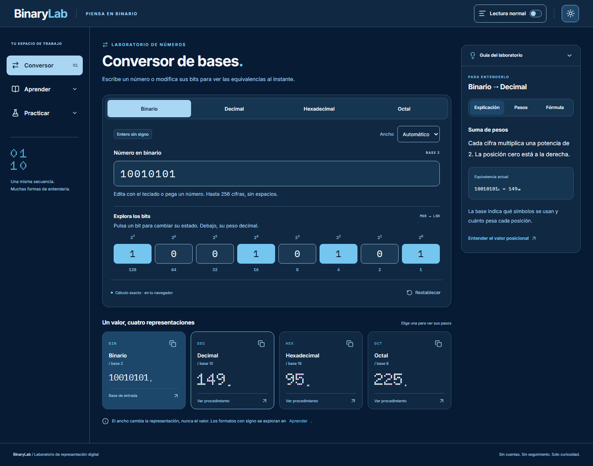

**[English](README.md) | [Español](README.es.md)**

# BinaryLab

A visual learning lab for number systems and computer data representation. Convert between bases, edit bits and follow the calculations step by step, then explore the theory and practise with guided exercises.

Documentation is available in English and Spanish. The application currently supports Spanish only.



Actual screenshot of the converter in dark mode.

## Features

- **Convert:** binary, octal, decimal and hexadecimal input, direct bit editing, selectable bit width and step-by-step conversion procedures.
- **Learn:** 25 topics, a glossary and interactive demonstrations covering binary arithmetic, signed integers, BCD, fractions, IEEE 754, text and colour.
- **Practise:** 84 activities across 21 categories, with multiple-choice and written-answer modes, hints and explained feedback.
- **Read comfortably:** responsive layouts for desktop, tablet and mobile, light and dark themes, and a comfortable reading mode.

Calculations run in the browser. There are no accounts, backend or analytics, and preferences, answers and progress are not persisted.

## Architecture and engineering decisions

React and strict TypeScript structure the interface; Vite and Tailwind CSS handle the build and styling. React Router manages navigation, Radix UI provides dialog and tab primitives, and Lucide React supplies icons.

```text
src/domain/      Pure calculations and answer evaluation
src/content/     Topics, glossary, activity data and evaluation definitions
src/features/    Converter, learning and practice flows
src/components/  Shared interface components
src/app/         Application shell and routes
e2e/             Browser navigation and interaction tests
```

- **Exact arithmetic where required:** [integer calculations](src/domain/numerals.ts) use `bigint`, including values beyond `Number.MAX_SAFE_INTEGER`. The [representation module](src/domain/representations.ts) uses `bigint` numerators and denominators for exact fractions, and `DataView` and `ArrayBuffer` to expose IEEE 754 representations and rounding.
- **Typed answer evaluators:** [evaluation and validation rules](src/domain/answers.ts) distinguish integer, rational, bit-pattern and conceptual answers. Evaluation separates incorrect values from empty input and format errors. Multiple-choice activities provide four complete alternatives with exactly one correct answer.
- **Independent checks:** Vitest and React Testing Library exercise the domain and components. [Content tests](src/content/content.test.ts) check the 84 solutions against an independent expected-answer oracle and use reviewed hashes to detect educational content changes. Playwright covers browser flows.

See the [architecture and contracts](docs/architecture.md) and [content integrity process](docs/content-integrity.md).

## Run locally

Use Node **24.22.2**, pinned in [.nvmrc](.nvmrc), and npm. Activate that Node version with your preferred version manager, then run from the project root:

```sh
npm ci
npm run dev
```

Open [127.0.0.1:5173](http://127.0.0.1:5173/). The port must be free.

## Verification

After installing dependencies:

```sh
npm run check
npm run test:toolchain
npm run browser:install
npm run test:e2e
```

`check` validates third-party notices, TypeScript, ESLint, Prettier, unit/component tests and the production build. The toolchain check validates the pinned Node version and runs targeted dependency compatibility checks. Playwright installs Chromium in `artifacts/pw-browsers/` and tests that build using the project's own configuration. Keep port **4173** free so the tests serve this copy of the application. On Linux, system dependencies can be installed with `npm run browser:install -- --with-deps`.

**Latest local application validation: 2 November 2026, Node 24.22.2.** `npm run check` passed with **153 unit/component tests in seven files**; `npm run test:e2e` passed all **22 Chromium E2E tests**, without failures or skipped tests. These are recorded local results, not a remote CI run, deployed-site validation or WCAG certification. See [verification details and limits](docs/verification.md) and the [dependency review](docs/dependency-review.md).

## Production build and static deployment

```sh
npm run build
npm run preview -- --port 4173
```

The build produces `dist/`; preview serves it locally on port 4173. [GitHub Actions](.github/workflows/ci.yml) is configured for a clean npm installation and the checks above, including Chromium system dependencies. [Netlify configuration](netlify.toml) defines the build, output directory and SPA fallback for direct navigation to nested routes. Node is pinned through `.nvmrc`. No remote CI run or live deployment is claimed.

## Licences and attribution

BinaryLab's own code authorised for licensing is covered by [MIT](LICENSE), Copyright (c) 2026 CaarlosMrtnz. Read [LICENSE-SCOPE.md](LICENSE-SCOPE.md) for the exact scope.

**MIT does not cover the educational content:** topics, glossary, exercise wording, solutions, explanations and hints. No reuse licence is granted for that material, and its ownership is not automatically attributed to the code author. Mathematical concepts are distinct from the wording used to explain them. The [provenance note](docs/content-provenance.md) describes the academic references, editorial review and its limitations; that review does not establish authorship or grant third-party permissions. The source academic PDFs and private working databases are not redistributed.

Inter, Doto, IBM Plex Mono and Jersey 15 retain their SIL OFL licences in [public/fonts/](public/fonts/). Libraries and icons retain their original licences and [third-party notices](public/THIRD-PARTY-NOTICES.txt).
